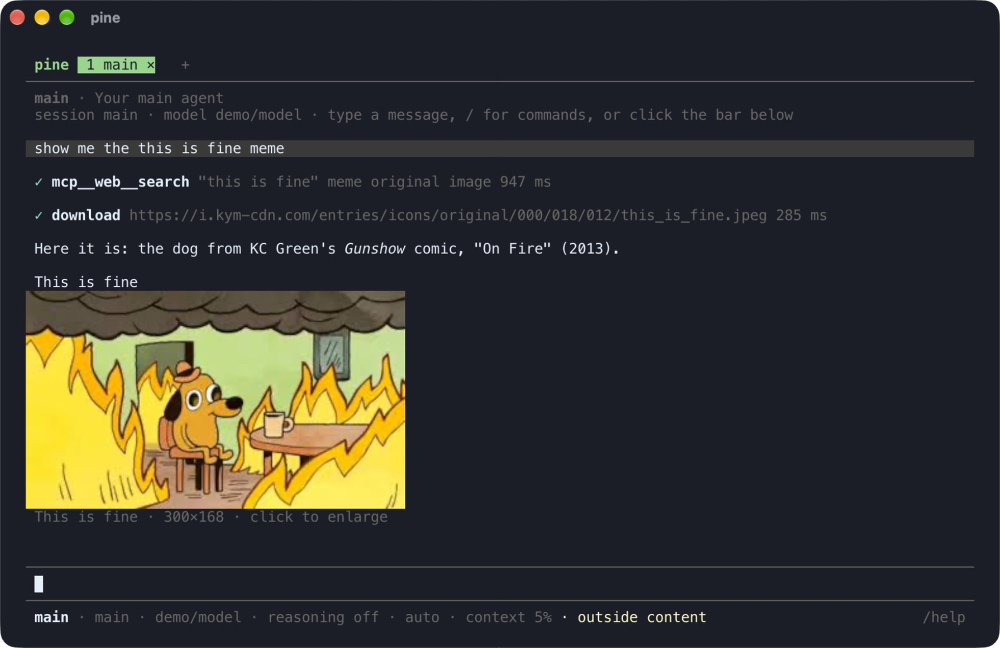
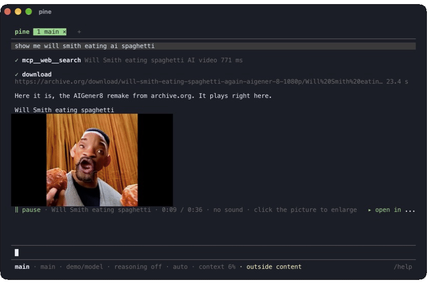
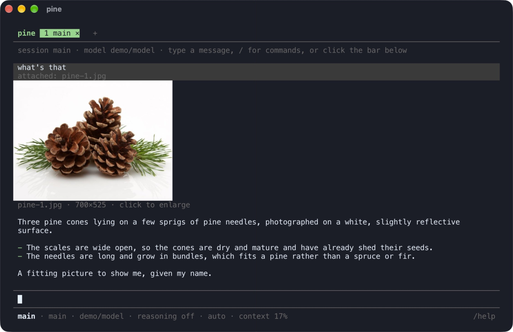
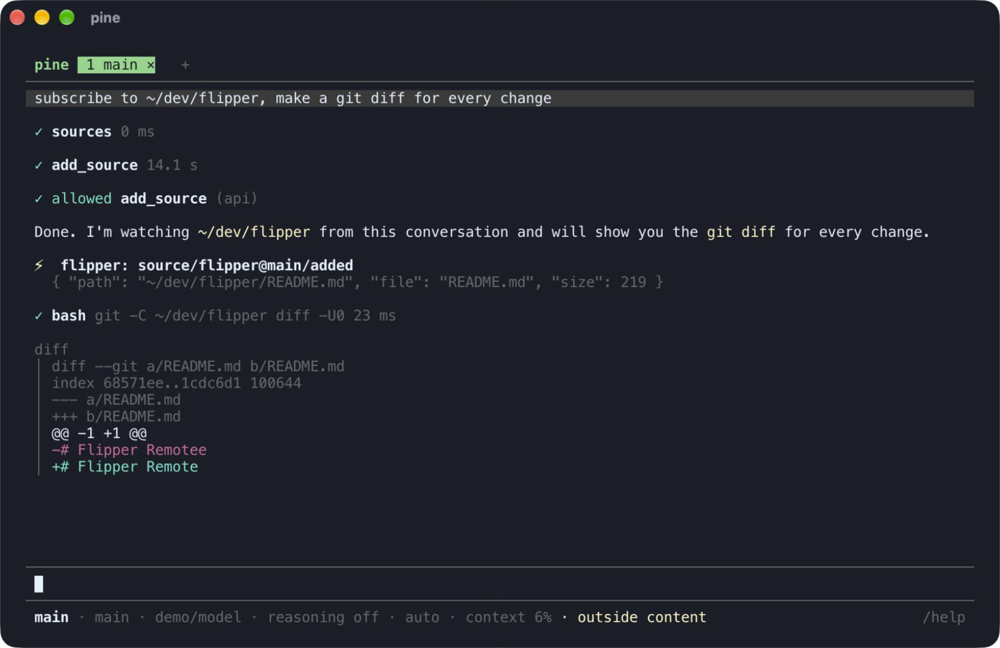
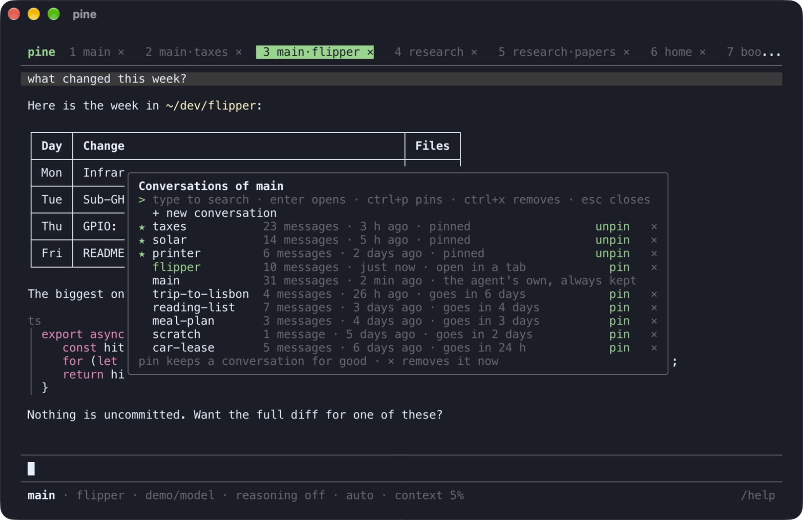
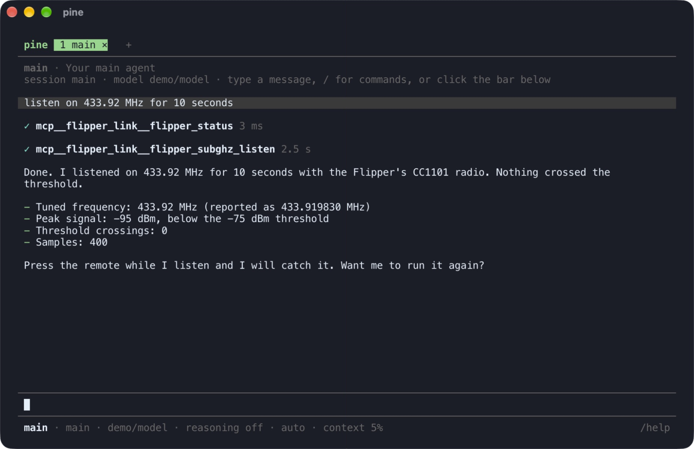
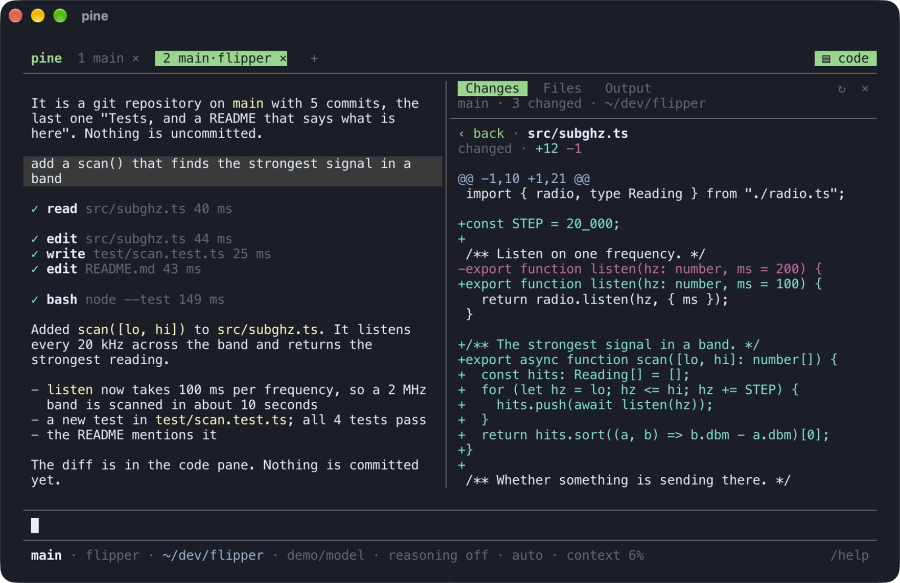
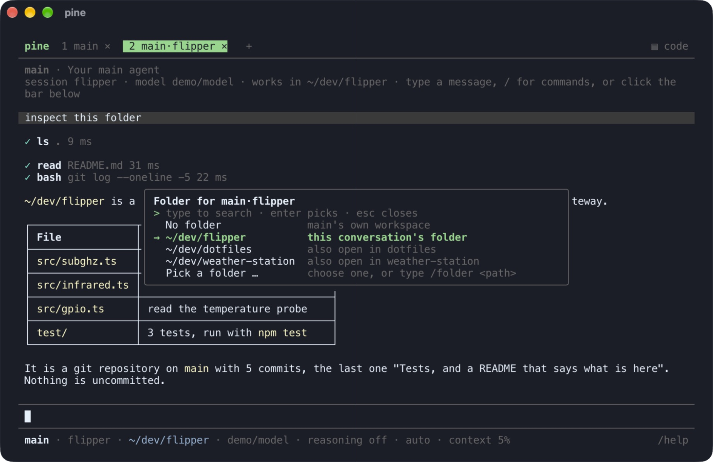

<h1 align="center">
  <picture>
    <source media="(prefers-color-scheme: dark)" srcset="docs/images/logo-dark.svg">
    
  </picture>
</h1>

This is a small daemon that runs several AI agents. Yes, you've heard that before.

<div align="center">
<code>
+ OpenCode, with a fresh GUI
+ OpenClaw automation, without configs or the weight
+ PI coding agent for basic turns, auto compact and model providers
-------------------------------------------------------------------
= PINE
</code>
</div>

Some things it does very different:

- **Letting agents react to external events**: chat, FTP, webhooks, MQTT, timers, etc. In a simple, modular way, and without configs. Agents can subscribe to any installed event source and react accordingly, or list available sources and unsubscribe. Event sources are simple to create, it's a \*.ts service with a schema. This allows you to create full automation workflows by just stating what you want: "watch my security cam, ring the alarm if someone enters while i'm away".
- **No configs**: you tell the agent what you want. They operate through safe tool calls. Main agent can create other agents, global MCPs, event sources, etc. Other agents can create these either for local conversations or their scope. No agent will touch or bypass into user config (where you tokens are).
- **A CLI that feels new**. Like a desktop UI. Interactive tabs, buttons, scroll regions. Images and videos are actually shown, formats markdown. Drag and drop files with real thumbails - and yes it's running in your shell (all Kitty shells, GHOSTTY et al, with lower quality fallbacks for old terminals).
- **All basics inbuilt**: computer use, tool calls, internet, browsing and operating live websites
- **Coding assistance**: diffs, output files, git integration, current folders ...
- **Orchestrating agents**, sub-agents, ... well, yes it does that. In an intuitive way. A pinned tab is a persistent agent. Create an agent, open a tab, rename it, tell it its basic instructions (these go into AGENTS.md), connect it to event sources, for instance Telegram if you want to chat abroad, pin it, close the tab if you want (you find it back in the running sessions), you're done.

<p align="center">
  
  
</p>
<p align="center">
  
  
</p>
<p align="center">
  
  
</p>
<p align="center">
  
  
</p>
<p align="center"><sub>Pictures and video from the web · drag and drop · subscribing to a folder and waking on a change · tabs, agents and conversations · MCP tools · the code pane with git diffs · a folder per conversation</sub></p>

```
 Telegram ─┐                                   ┌─ rule: set state, publish
 MQTT ─────┤                                   │
 files ────┼─► event log ─► routes ────────────┼─ one model call
 webhooks ─┤   (SQLite)     filter, debounce   │
 schedules ┘       ▲                           └─ agent turn (pi session)
       ...         │                                │  delegate ─► other agents
                   └──── answers, agent events ◄────┘  subagent ─► parallel copies
```

## Quick start

Requires Node 24 or newer and macOS (for the sandbox).

```bash
npm install -g @pmndrs/pine
```

Sets everything up: the browser the web tools drive, and your user folder (`~/.pine`).

```bash
pine init
```

Checks the setup: validates the configuration, lists each agent with its model, tools and MCP
servers, and prints security notes if something is open that should not be.

```bash
pine check
```

Opens the terminal UI. If no daemon is running, it starts one inside and stops it when you quit.

```bash
pine
```

Runs the daemon alone, without the UI, so agents keep reacting to events with no terminal
open. `pine` then attaches to it. To have it start at login, see
[operations.md](docs/references/operations.md).

```bash
pine start
```

That is a home in `~/.pine` with one agent, `main`, and the terminal UI talking to it. Out of
the box the model is Claude through `claude -p`, so Claude Code has to be installed and signed
in. To use something else, sign in and switch with `/model` in the UI:

```bash
pine login opencode-go
```

`pine login anthropic` and `pine login openai-codex` use a Claude or ChatGPT subscription; a
local llama-server goes into `~/.pine/models.json`. See
[operations.md](docs/references/operations.md) and [tui.md](docs/references/tui.md).

To work on a project, start it in that folder. The agent gets that folder for the
conversation, and `▤ code` (or `ctrl+g`) opens a pane with git changes and diffs, the files and
the output of its tool calls ([coding.md](docs/references/coding.md)):

```bash
pine .
```

To get a newer version later, with whatever it needs:

```bash
pine update
```

## Documentation

Start at [docs/SKILL.md](docs/SKILL.md); it indexes everything.

| To do this                                                                              | Read                                                         |
| --------------------------------------------------------------------------------------- | ------------------------------------------------------------ |
| Understand how the pieces fit                                                           | [overview.md](docs/references/overview.md)                   |
| Use the terminal UI                                                                     | [tui.md](docs/references/tui.md)                             |
| Work on a project: `pine .`, the code pane with git changes, files and tool output      | [coding.md](docs/references/coding.md)                       |
| Install, run, use the CLI, run it as a service                                          | [operations.md](docs/references/operations.md)               |
| Write `pine.json` and `agent.json`                                                      | [configuration.md](docs/references/configuration.md)         |
| Let agents set things up by tool call instead of editing files                          | [setup.md](docs/references/setup.md)                         |
| Set up agents, delegation and sub-agents                                                | [agents.md](docs/references/agents.md)                       |
| Route events, schedules, model calls                                                    | [events.md](docs/references/events.md)                       |
| Event sources agents subscribe to: folders, MQTT devices, webhooks, FTP uploads, timers | [sources.md](docs/references/sources.md)                     |
| Telegram, MQTT publishing, your own plugins                                             | [plugins.md](docs/references/plugins.md)                     |
| MCP servers, web search, command tools                                                  | [mcp.md](docs/references/mcp.md)                             |
| Know what is protected and what is not                                                  | [security.md](docs/references/security.md)                   |
| Work on pine itself                                                                     | [AGENTS.md](AGENTS.md), [stack.md](docs/references/stack.md) |

## Tests

```bash
npm test
```

About ten seconds: every test runs against a scripted model server, nothing leaves the
machine. `npm run test:live` adds a run against a real model through `claude -p` and one with
the real browser.
`npm run check` type-checks. `npm run baseline` re-runs the 59 checks that chart how the pi SDK
behaves when embedded ([baseline/RESULTS.md](baseline/RESULTS.md)).

## Status

Version 0.1. Verified against a scripted model and against Claude through `claude -p`. Not yet
run against llama.cpp, a quantised local model, or a hosted provider signed in with
`pine login`; see the open points at the end of [stack.md](docs/references/stack.md).
