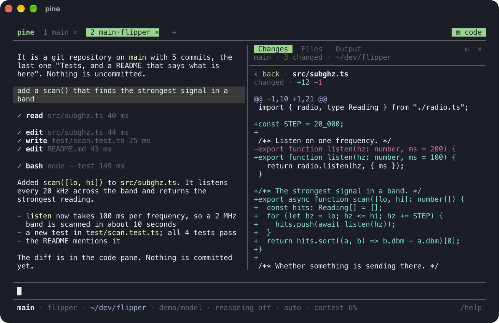
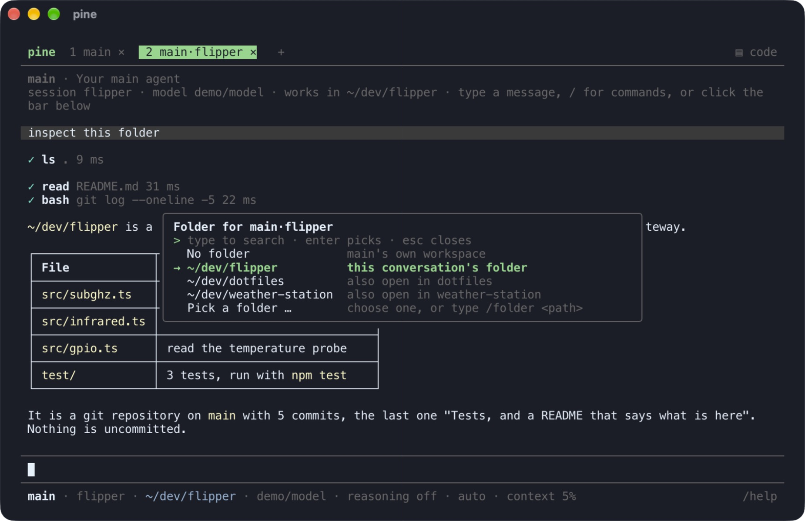

# Working on code

Two things turn a conversation into a place to work on a project: a **folder** that is opened
for it, and the **code pane** beside it that shows what git says changed there, the files, and
what the agent's tool calls printed.

```bash
cd ~/dev/shop
pine .
```



## A folder for a conversation

An agent works in its own workspace. A conversation can be given a folder of yours on top of
that: a repository, a project. From its next message on

- the agent's shell and file tools start in that folder (a relative path means a path there),
- it may read and change what is in it, like its own workspace,
- the folder's instruction files (`AGENTS.md`, `CLAUDE.md`) apply, next to the agent's own,
- the agent is told which folder it works in and that its own workspace is still there.

Everything else stays as it is: for an agent in the workspace scope the rest of your home is
closed and the network is closed unless you opened it, and the agent's mode decides what it
asks before doing.

The main agent reaches your whole account anyway (`sandbox.scope`, see
[security.md](security.md)), so it can work on a project without a folder being opened.
Opening one still does three things for it: its tools start there, the folder's instruction
files apply, and the folder stays open to the conversation after it has read outside content,
when the rest of your account is closed until you say otherwise.

The folder belongs to that one conversation. Another conversation of the same agent does not
have it, and neither has another agent it delegates to; sub-agents it starts do. It stays until
you take it away or remove the conversation, also across restarts. A renamed conversation
keeps it.

There are four ways to open one:

| | |
|---|---|
| `pine .` or `pine <folder>` | Starts the terminal UI with the tabs of last time and one more on that folder: a conversation of the main agent, named after the folder. If a conversation already works there, that one is opened again |
| The folder in the bottom bar | Click it (`no folder`, or the folder's path) for a list: no folder, this conversation's folder, the folder pine was started in (unless that is your home folder), folders other conversations of this agent use, and "Pick a folder …", which opens the system's folder chooser on macOS |
| `/folder <path>`, `/folder none` | The same by command (`off` and `-` mean `none` too). `/folder` alone opens the list |
| Drag a folder onto the terminal | It becomes the folder of the conversation in front. (A file dropped there is attached to your next message, as always) |



Only you can do this. There is no tool for it: an agent cannot open a folder for itself, and
nothing an agent reads can.

A folder is refused when it is, contains or lies in pine's home (your home folder contains it,
if pine's home is `~/.pine`), pine's own program, or another agent's workspace. It cannot be
changed while the conversation is working.

For a project an agent should always work in, without opening anything, set `workspace` in its
`agent.json` instead ([agents.md](agents.md)).

## The code pane

`▤ code` at the right end of the tab bar, `ctrl+g` or `/code` opens a pane beside the
conversation; the same closes it. It shows the conversation's folder, or the agent's workspace
when no folder is open. In a terminal of 100 columns or more it takes half the width (at most
96 columns); in a narrower one it takes the place of the conversation until it is closed.

```
 pine  1 main ×  2 main·shop ×   +                                                  ▤ code
───────────────────────────────────────────────────────────────────────────────────────────
 make the total include shipping          │  Changes   Files   Output                 ↻  ×
                                          │ main · 2 changed · ~/dev/shop
 ✓ edit src/cart.ts 12 ms                 │─────────────────────────────────────────────────
 ✓ bash npm test 2.1 s                    │ M src/cart.ts  +4 −1
                                          │ + src/shipping.ts  +12
 The total now includes shipping ...      │
```

| View | Shows | A click |
|---|---|---|
| **Changes** | What differs from the last commit: changed (`M`), added (`A`), new (`+`), deleted (`D`) and renamed (`R`) files with the lines added and removed, and the branch | on a file shows its diff, added lines green and removed ones red; `‹ back` returns to the list |
| **Files** | The folder as a tree | on a folder opens or closes it; on a file shows its text with line numbers and colours, or a picture as a picture |
| **Output** | Every tool call of the conversation's last 8 messages, newest first: the tool, what it was called with, how long it took | on a call shows everything it printed, not only the first lines the conversation shows |

The pane follows the agent: when a tool call finishes, what is shown is read again, so a diff
grows while the agent edits. `↻` reads it again by hand, `×` closes the pane. The wheel scrolls
whichever side the pointer is over. Whether the pane was open is remembered for the next start.

`/code changes`, `/code files` and `/code output` open it on that view; `/code off` closes it.

The pane only shows. It changes no file, runs no command of the project and sends nothing to a
model. Long lines wrap. A file is shown up to 256 KB, a diff up to 200 000 characters, a tool's
output up to 200 000 characters and 4000 lines; binary files are named, not shown. Changes
lists the first 300 files, and Files shows up to 500 entries of a folder.

While the pane is open, pictures and videos in the conversation are drawn with coloured half
blocks also on terminals that can show real pictures. A terminal draws a real picture only at
the left edge of a full line, where it would lie across the pane.

## What it is safe against

- **Looking is not running.** A repository can name programs for git to start: a diff driver, a
  text converter, hooks, a file system monitor. The pane runs git in a sandbox that can write
  nothing and has no network, and with those features switched off, so a folder you only opened
  to look at cannot make anything run.
- **Nothing outside the folder.** Paths are resolved with their links and must stay inside the
  folder; a link that leads out of it is neither listed nor opened.
- **A folder is for your conversation, not for what arrives in it.** A run that an outside
  event started, not you, does not get the folder: it works in the agent's own workspace. A
  conversation of yours that has read outside content (a web page) keeps the folder, with the
  two limits below. See [security.md](security.md).
- **Instruction files.** `AGENTS.md` and `CLAUDE.md` of an opened folder are instructions to
  the agent, like those of its workspace. Open folders you trust as much as you trust their
  authors with your agent. Once a conversation has read outside content, it can no longer
  change these files.
- **Git hooks and configuration.** What lies in `.git/hooks` and `.git/config` runs with your
  rights the next time you use git in that folder. A conversation that has read outside content
  can still commit and branch there but cannot change those. One that has read none can, like
  the rest of the folder: it acts on what you told it.

## From a script

The control API ([operations.md](operations.md)) has the same things:

| Request | Purpose |
|---|---|
| `GET /agents/<id>/folder?session=` | The folder of a conversation, and the agent's workspace |
| `GET /agents/<id>/folders` | Every conversation of the agent that has a folder |
| `POST /agents/<id>/folder` `{ session, folder }` | Open a folder for a conversation; `folder: null` closes it |
| `GET /agents/<id>/view/changes?session=` | What git says changed in the conversation's folder |
| `GET /agents/<id>/view/diff?session=&path=` | The diff of one file (path from the top of the repository) |
| `GET /agents/<id>/view/tree?session=&path=` | What is in one folder (path from the conversation's folder) |
| `GET /agents/<id>/view/file?session=&path=` | A file's text |
| `GET /tasks/<id>/transcript?full=1` | A task's steps with the whole output of each tool call |
